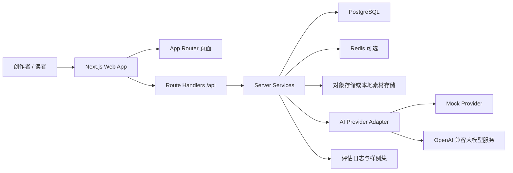
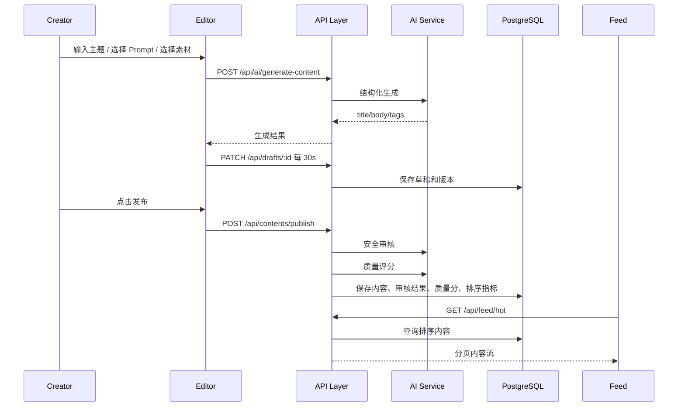

# 技术选型与架构设计

## 1. 设计原则

本项目按“以终为始”的方式设计：最终提交文档需要展示完整体验、架构说明、审核规则、质量评估、效果评估、README、测试说明和项目自评，因此开发过程本身要持续产出这些证据。

架构设计遵循四个原则：

- 主链路优先：先保证“登录 -> 创作 -> 审核 -> 发布 -> 榜单 -> 详情”完整可跑。
- AI 可控：所有 AI 输出必须结构化、可校验、可降级、可记录。
- 分发可解释：榜单排序先采用明确公式，后续再增强动态权重。
- 文档同源：架构、规则、Prompt、评估样例和测试脚本随代码一起维护。

## 2. 终态提交模板对架构的约束

从提交模板反推，项目不能只完成页面，还必须能回答以下问题：

- 体验地址：系统必须有公开可访问入口、测试账号和可录制的演示主线。
- 项目介绍：页面需要有足够完整的产品氛围和截图素材。
- 技术文档：代码结构需要能清晰映射到前端、后端、存储、AI 服务和数据流。
- 审核规则与质量评估体系：审核和评分不能散落在 UI 里，必须形成规则库和可说明标准。
- 效果评估与优化报告：AI Prompt、审核准确率、LCP、排序效果需要在开发期持续记录。
- 代码压缩包：README、目录结构、启动步骤和测试说明要从第一天开始维护。
- 项目自评：需求完成度、未完成项和长期建设路线需要可追踪。

对应到工程设计，必须保留这些一等公民模块：

- `docs/`：架构、规则、评估、工作记录。
- `evals/`：审核样例、质量评分样例、Prompt 调优记录和评估脚本。
- `src/server/ai/`：模型适配层、Prompt 编排、结构化输出校验。
- `src/server/audit/`：安全规则、审核流程、处置策略。
- `src/server/ranking/`：榜单排序公式、指标归一化、缓存策略。

## 3. 技术选型

### 3.1 总体选择

采用单仓库全栈 TypeScript 方案：

- 应用框架：Next.js App Router。
- 前端：React + TypeScript。
- 服务端：Next.js Route Handlers 作为 BFF 和轻量 API 层。
- 数据库：PostgreSQL + Prisma。
- 缓存与队列：Redis 作为可选增强，MVP 可以先用数据库预计算字段兜底。
- AI 接入：OpenAI SDK 兼容模式，适配火山方舟或其他兼容模型；同时内置 Mock Provider。
- 样式：Tailwind CSS + 少量自定义组件。
- 图标：lucide-react。
- 表单与校验：React Hook Form + Zod。
- 客户端请求：TanStack Query，用于创作台数据、自动保存、无限滚动。
- 离线草稿：IndexedDB，建议使用 Dexie 封装。
- 测试：Vitest + Testing Library + Playwright。

### 3.2 为什么选择 Next.js

Next.js 对本项目的收益：

- 同一个 TypeScript 工程内完成页面、API、服务端渲染和部署，适合三周训练营节奏。
- 榜单页可以使用服务端渲染或静态预取首屏数据，帮助 LCP 达到 2.5 秒目标。
- Route Handlers 足够承载 MVP API，后续可以平滑拆成独立 NestJS 服务。
- App Router 的路由分组适合把创作者端、消费端和认证页分开组织。

边界控制：

- 不把业务逻辑直接写在 Route Handler 里。
- Route Handler 只做鉴权、参数校验、调用 service、返回响应。
- 业务逻辑沉到 `src/server/*`，未来独立服务化时迁移成本更低。

### 3.3 为什么选择 PostgreSQL + Prisma

PostgreSQL 适合存储用户、草稿、内容、审核结果、评分、榜单指标等强结构数据。Prisma 适合快速建立类型安全的数据访问层，并直接沉淀数据库设计文档。

MVP 不强依赖 MongoDB；素材正文、审核 JSON、评分 JSON 可以用 PostgreSQL 的 JSON 字段承载。Redis 暂作为性能增强，用于榜单缓存、热点指标缓存和频控。

### 3.4 AI 能力选型

AI 层采用 Provider Adapter：

```text
UI / API
  -> aiService
  -> promptBuilder
  -> provider.generateJson
  -> zod schema validation
  -> retry / fallback / audit log
```

运行模式：

- `mock`：本地开发和测试使用，不依赖外部网络。
- `openai-compatible`：通过 `AI_BASE_URL`、`AI_API_KEY`、`AI_MODEL` 调用兼容服务。
- `volcengine-ark`：作为 OpenAI 兼容模式的一种配置方案。

关键要求：

- 生成、审核、改写、评分分别定义 JSON Schema。
- 模型输出不合法时自动重试一次。
- 重试仍失败时返回可解释错误，不能阻断编辑器保存。
- 每次调用记录模型、耗时、输入摘要、输出摘要、schema 校验结果。

## 4. 总体架构



核心数据流：



## 5. 项目脚手架

建议的代码目录：

```text
.
├── README.md
├── package.json
├── pnpm-workspace.yaml
├── next.config.ts
├── tsconfig.json
├── prisma/
│   ├── schema.prisma
│   └── seed.ts
├── public/
│   └── demo-assets/
├── src/
│   ├── app/
│   │   ├── (auth)/
│   │   │   ├── login/page.tsx
│   │   │   └── register/page.tsx
│   │   ├── (creator)/
│   │   │   ├── dashboard/page.tsx
│   │   │   ├── prompts/page.tsx
│   │   │   ├── assets/page.tsx
│   │   │   ├── create/page.tsx
│   │   │   └── editor/[draftId]/page.tsx
│   │   ├── (feed)/
│   │   │   ├── page.tsx
│   │   │   ├── hot/page.tsx
│   │   │   ├── viral/page.tsx
│   │   │   └── content/[contentId]/page.tsx
│   │   └── api/
│   │       ├── auth/
│   │       ├── prompts/
│   │       ├── assets/
│   │       ├── drafts/
│   │       ├── ai/
│   │       ├── audit/
│   │       ├── contents/
│   │       └── feed/
│   ├── components/
│   │   ├── ui/
│   │   ├── editor/
│   │   ├── feed/
│   │   └── creator/
│   ├── features/
│   │   ├── auth/
│   │   ├── creator/
│   │   ├── editor/
│   │   ├── audit/
│   │   ├── quality/
│   │   └── feed/
│   ├── hooks/
│   │   ├── use-autosave-draft.ts
│   │   ├── use-offline-sync.ts
│   │   └── use-infinite-feed.ts
│   ├── lib/
│   │   ├── db.ts
│   │   ├── env.ts
│   │   ├── errors.ts
│   │   ├── logger.ts
│   │   ├── result.ts
│   │   └── schemas.ts
│   └── server/
│       ├── auth/
│       ├── prompts/
│       ├── assets/
│       ├── drafts/
│       ├── contents/
│       ├── ai/
│       ├── audit/
│       ├── quality/
│       └── ranking/
├── evals/
│   ├── audit-cases.json
│   ├── quality-cases.json
│   ├── prompt-iterations.md
│   └── scripts/
└── docs/
    ├── task-structured-requirements.md
    ├── architecture-and-implementation-plan.md
    ├── audit-and-quality-system.md
    ├── evaluation-report.md
    └── worklogs/
```

## 6. 模块边界

### 6.1 Auth

职责：

- 注册、登录、退出。
- 会话校验。
- 路由保护。

MVP 策略：

- 邮箱 + 密码作为主路径。
- 手机号登录先做字段兼容，不接真实短信服务。
- 使用 HttpOnly Cookie 保存 session。

不负责：

- AI 调用。
- 内容权限之外的业务校验。

### 6.2 Prompt

职责：

- Prompt 模板的增删改查。
- 按用途分类：内容生成、审核、改写、质量评分。
- 为 AI 服务提供 Prompt 版本。

MVP 策略：

- 内置系统 Prompt seed。
- 用户可创建自己的创作 Prompt。
- 审核/评分 Prompt 先作为系统模板，不对普通用户开放编辑。

### 6.3 Asset

职责：

- 素材上传、列表、删除。
- 素材类型和大小校验。
- 基础合规状态记录。

MVP 策略：

- 本地开发使用 `public/demo-assets` 或本地上传目录。
- 生产部署抽象为对象存储接口。
- 图片素材先支持 URL 和文件名展示，视频/音频作为扩展字段保留。

### 6.4 Editor / Draft

职责：

- 内容编辑状态。
- 每 30 秒自动保存。
- 断网本地写入。
- 网络恢复后同步。
- 版本号和冲突检测。

MVP 策略：

- 编辑器使用标题、正文、封面、配图、标签的结构化表单。
- IndexedDB 保存本地草稿镜像和待同步队列。
- 服务端使用 `version` 做乐观锁。
- 冲突时保留本地版本，提示用户手动选择。

### 6.5 AI Creation

职责：

- 根据主题、Prompt、素材生成内容。
- 生成标题、正文、标签、配图建议。
- 记录 AI 调用日志。

MVP 策略：

- Mock Provider 可生成稳定样例，保证演示不中断。
- 真实 Provider 通过环境变量启用。
- 所有输出通过 Zod 校验。

### 6.6 Audit

职责：

- 内容安全审核。
- 风险分类、风险等级、命中片段、处置动作。
- 高危内容拦截。
- 合规改写入口。

MVP 策略：

- 规则预筛 + 模型审核。
- 规则预筛处理明显命中词和敏感模式。
- 模型审核输出结构化 JSON。
- 审核结果必须落库。

### 6.7 Quality

职责：

- 内容质量评分。
- 输出多维度分数、总分、理由和建议。
- 为排序提供 `qualityScore`。

MVP 策略：

- 六维评分：原创性、结构、可读性、信息密度、标题吸引力、图文匹配度。
- 总分存入 `QualityScore`。
- 评分理由展示在创作者发布确认面板。

### 6.8 Content

职责：

- 内容发布、更新、下线。
- 内容详情。
- 内容状态机。

状态机：

```text
draft -> reviewing -> published
draft -> reviewing -> rejected
published -> reviewing -> published
published -> offline
```

MVP 策略：

- 发布动作同步触发审核和评分。
- 审核未通过时不创建公开内容流记录。
- 已发布内容二次编辑后重新进入审核。

### 6.9 Ranking / Feed

职责：

- 榜单数据查询。
- 排序分计算。
- 无限滚动分页。
- 内容详情消费页。

MVP 策略：

- 预计算 `rankingScore`。
- 使用 cursor-based pagination。
- 榜单接口只返回卡片必要字段。
- 详情页再拉完整正文。

基础排序公式：

```text
rankingScore =
  qualityScore * 0.45
  + heatScore * 0.35
  + freshnessScore * 0.20
```

## 7. 数据模型

核心表：

- `users`
- `sessions`
- `prompts`
- `assets`
- `drafts`
- `draft_versions`
- `contents`
- `content_versions`
- `audit_results`
- `quality_scores`
- `ranking_metrics`
- `ai_call_logs`

关键关系：

- 一个用户拥有多个 Prompt、Asset、Draft、Content。
- Draft 可以关联 Content，用于发布后编辑。
- Content 拥有多个版本记录。
- Content 当前只指向最新 AuditResult 和 QualityScore。
- RankingMetric 与 Content 一对一，用于榜单查询。
- AICallLog 记录每次生成、审核、改写、评分调用。

## 8. API 设计策略

### 8.1 Route Handler 约定

每个 API 遵循同一形态：

```ts
type ApiResponse<T> =
  | { ok: true; data: T; traceId: string }
  | { ok: false; error: { code: string; message: string; details?: unknown }; traceId: string };
```

约定：

- 输入统一用 Zod 校验。
- 错误统一转为 `ApiResponse`。
- 所有写操作校验登录态和资源归属。
- 每个请求生成 `traceId`，便于日志定位。

### 8.2 MVP API 清单

优先实现：

- `POST /api/auth/register`
- `POST /api/auth/login`
- `POST /api/auth/logout`
- `GET /api/auth/me`
- `GET /api/prompts`
- `POST /api/prompts`
- `GET /api/assets`
- `POST /api/assets`
- `GET /api/drafts/latest`
- `POST /api/drafts`
- `PATCH /api/drafts/:id`
- `POST /api/drafts/:id/sync`
- `POST /api/ai/generate-content`
- `POST /api/ai/rewrite-compliant`
- `POST /api/contents/publish`
- `PATCH /api/contents/:id`
- `GET /api/feed/hot`
- `GET /api/feed/viral`
- `GET /api/feed/recommended`
- `GET /api/feed/:contentId`

后置实现：

- 内容下线。
- 内容撤回。
- 内容回滚。
- 开放平台热点接入。
- 运营权重配置。

## 9. 最小可展示闭环

MVP 演示路径必须在 3 到 5 分钟内讲清楚：

1. 使用测试账号登录。
2. 进入创作者工作台，看到草稿、已发布内容和内容质量概览。
3. 在 Prompt 管理中选择或创建一个创作 Prompt。
4. 选择素材，输入主题和风格。
5. 点击 AI 生成，得到标题、正文、标签、配图建议。
6. 进入编辑器，人工修改内容。
7. 展示自动保存状态；刷新页面后草稿恢复。
8. 点击发布，触发 AI 安全审核和质量评分。
9. 若内容合规，展示评分并发布成功。
10. 若内容违规，展示风险片段，一键生成合规替代内容，再次提交。
11. 进入热点或推荐榜单，看到刚发布内容出现在信息流中。
12. 滚动加载更多内容。
13. 点击内容卡片进入详情页。
14. 展示排序说明：质量分、热度、发布时间如何影响排序。

这条链路覆盖评分最高的两个维度：AI 工具深度应用与端到端体验。

## 10. 进阶功能如何围绕闭环增强

### 10.1 短图文创意编辑器

插入点：

- 位于第 4 到第 6 步之间。

增强方式：

- 从“输入主题生成正文”升级为“输入素材和思路，AI 生成标题、封面建议、图文段落、标签”。
- 支持逐段重写和人类确认。

### 10.2 高精度安全识别

插入点：

- 位于第 8 到第 10 步。

增强方式：

- 引入评估样例集。
- 输出准确率、召回率、误判案例。
- 增加下线、撤回、回滚能力。

### 10.3 动态加权榜单

插入点：

- 位于第 11 到第 14 步。

增强方式：

- 加入用户反馈、作者信誉、热点匹配度。
- 增加运营权重配置。
- 展示排序解释。

## 11. 页面设计边界

### 11.1 第一阶段页面

必须有：

- 登录页。
- 注册页。
- 创作者工作台。
- Prompt 管理页。
- 素材管理页。
- AI 创作页。
- 内容编辑器页。
- 发布审核结果面板。
- 热点榜单页。
- 内容详情页。

可以合并：

- 爆文榜单和推荐榜单可以先作为同一 Feed 页面上的 Tab。
- 合规改写可以先作为编辑器侧边面板。
- 质量评分可以先作为发布确认面板的一部分。

### 11.2 第一阶段 UI 风格

产品是创作者生产工具，不做营销型 landing page。第一屏应直接进入工作台或内容流：

- 创作者端：安静、清晰、工具感强，突出编辑效率和状态反馈。
- 消费端：信息流氛围更强，卡片视觉稳定，首屏加载快。
- 不使用大面积单色渐变背景。
- 工具按钮优先使用 lucide 图标和 tooltip。
- 固定工具栏、榜单卡片、编辑器面板需要有稳定尺寸，避免动态内容导致布局跳动。

## 12. 性能设计

目标：

- 榜单页 LCP <= 2.5 秒。
- 榜单滚动加载不卡顿。
- 发布流程中 AI 慢请求不影响草稿保存。

措施：

- 榜单首屏服务端渲染或服务端预取。
- 首屏只返回必要字段：标题、摘要、封面、作者、分数、热度、发布时间。
- 图片使用固定宽高、懒加载、合适尺寸。
- 列表使用 cursor 分页。
- 排序分提前计算，查询时避免复杂实时聚合。
- AI 请求只在创作者操作中触发，不阻塞消费端首屏。
- 使用 Web Vitals 记录 LCP。

## 13. 可用性和降级

AI 服务失败：

- 内容生成失败：展示重试，保留用户输入。
- 审核失败但不是内容违规：进入人工稍后重试状态，不直接发布。
- 质量评分失败：可发布但标记 `qualityScorePending`，榜单使用默认低权重。
- 合规改写失败：保留审核结果，允许用户手动修改。

网络断开：

- 编辑器继续可输入。
- 本地 IndexedDB 写入草稿和待同步队列。
- 页面顶部显示离线状态。
- 网络恢复后自动同步。

发布冲突：

- 服务端版本号不匹配时返回冲突。
- 客户端保留本地版本，并展示云端版本时间。

## 14. 安全与内容治理设计

审核流程：

```text
提交内容
  -> 规则预筛
  -> 模型审核
  -> 风险归并
  -> 处置决策
  -> 审核结果落库
  -> 通过则质量评分并发布
  -> 不通过则展示风险和改写入口
```

处置策略：

- `none`：允许发布。
- `low`：允许发布但给出优化建议。
- `medium`：要求修改后再发布。
- `high`：自动拦截，必须改写或人工处理。

需要沉淀到后续规则文档：

- 各风险分类的定义边界。
- 违规样例和正常样例。
- 处置方式。
- 误判处理。
- 下线、撤回、回滚的进阶流程。

## 15. 评估体系

开发期同步维护：

- `evals/audit-cases.json`：安全审核样例。
- `evals/quality-cases.json`：质量评分样例。
- `evals/prompt-iterations.md`：Prompt 调优记录。
- `docs/evaluation-report.md`：效果评估与优化报告草稿。

评估指标：

- 审核准确率，目标高危问题 >= 90%。
- 审核误杀率。
- 合规改写可接受率。
- 质量评分人工一致性。
- 榜单 LCP。
- 榜单接口 P95 延迟。
- AI 调用成功率和平均耗时。

## 16. 第一阶段实施计划

### 16.1 初始化阶段

- 初始化 Next.js + TypeScript 项目。
- 配置 Tailwind、ESLint、Prettier、Vitest、Playwright。
- 配置 Prisma 和数据库连接。
- 建立基础目录结构。
- 建立 README。

### 16.2 主链路阶段

- Auth：注册、登录、退出和路由保护。
- Prompt：列表、创建、编辑。
- Asset：基础素材管理。
- AI Creation：Mock Provider + 真实 Provider 适配层。
- Editor：生成内容、编辑、自动保存、恢复草稿。
- Content：发布流程。

### 16.3 审核与分发阶段

- Audit：规则预筛、模型审核、拦截和改写。
- Quality：评分维度和总分。
- Ranking：排序分计算。
- Feed：热点榜单、无限滚动、详情页。

### 16.4 打磨与提交阶段

- LCP 优化和实测记录。
- 审核样例集和准确率统计。
- 演示视频脚本。
- 技术文档、规则文档、评估报告、项目自评。
- 线上部署和测试账号准备。

## 17. 决策记录

| 决策 | 选择 | 原因 |
| --- | --- | --- |
| 工程形态 | Next.js 全栈单仓库 | 三周内更容易完成端到端闭环，减少前后端集成成本 |
| 业务逻辑位置 | `src/server/*` | 避免 Route Handler 膨胀，后续可拆服务 |
| 数据库 | PostgreSQL + Prisma | 结构化数据强、类型安全、便于文档化 |
| AI 接入 | OpenAI SDK 兼容适配层 + Mock Provider | 兼容火山方舟，保证本地演示和测试稳定 |
| 编辑器 | 结构化图文编辑器优先 | 比富文本编辑器更可控，利于草稿同步和审核 |
| 榜单排序 | 预计算加权公式 | 可解释、性能可控、适合提交答辩 |
| 离线草稿 | IndexedDB + 服务端版本号 | 覆盖断网可编辑和恢复后同步，复杂度可控 |

## 18. 下一步执行

下一步进入脚手架初始化和主链路开发：

- 创建 Next.js 项目基础文件。
- 建立 Prisma schema。
- 建立 Mock AI Provider。
- 先跑通登录、AI 生成、草稿保存和发布前审核的纵向切片。

