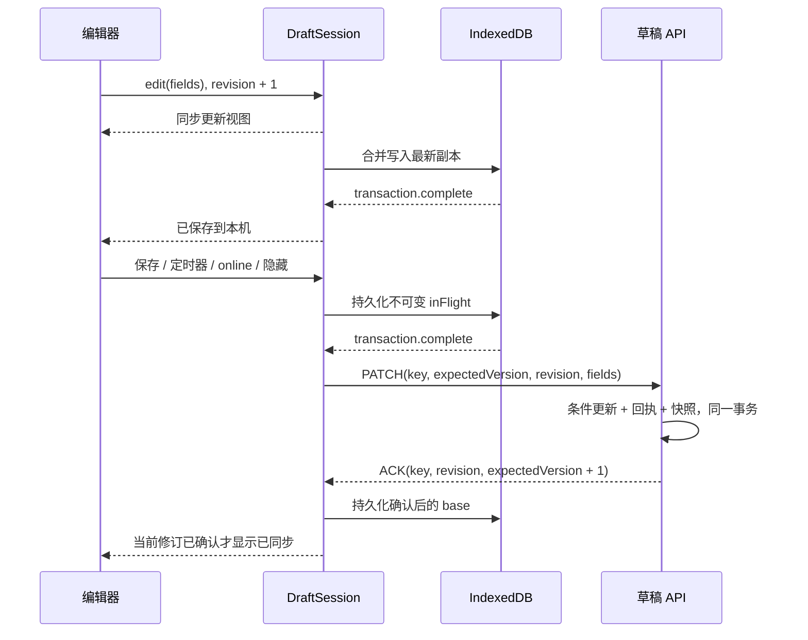

# 草稿同步设计

## 问题与边界

编辑器需要同时应对输入、浏览器存储、网络和多设备写入。旧实现把在线本地副本当作已同步，按定时器无条件保存，用先查后写的版本判断处理并发，并允许 AI 路由直接改写草稿。其结果是关页丢修改、版本空增、旧响应覆盖输入，以及发布内容与眼前内容不一致。

本设计使用本地副本、原子条件更新和可重放操作。它适用于个人草稿的跨设备编辑，不提供多人实时协作，也不使用 Service Worker。普通保存、合并、历史恢复和接受 AI 建议都进入同一个同步管道。

## 八项约束

| 约束 | 实现含义 |
| --- | --- |
| I1 本机保存 | 只有当前修订对应的 IndexedDB 事务触发 `complete` 才显示“已保存到本机”。默认 durability 不承诺操作系统崩溃或断电恢复。 |
| I2 云端确认 | ACK 的 operationId、localRevision 必须匹配待发操作，serverVersion 必须等于 expectedVersion + 1；旧 ACK 不确认后来输入。读取云端、撤销到已确认内容、接受完全相同的云端合并结果可复用已有确认。 |
| I3 原子版本 | `UPDATE ... WHERE id = ? AND ownerId = ? AND version = ?` 成功时版本只增加 1。未来版本号也冲突。 |
| I4 幂等操作 | 同一个 owner/draft/operationId 和同一请求体返回原 ACK；不同请求体返回 422。 |
| I5 可恢复 | 冲突保留本机与云端内容，提供显式选择、历史快照和另存为新草稿。 |
| I6 单写者 | 支持 Web Locks 的同一浏览器、同一 origin 中，一篇草稿只有一个标签页可编辑。 |
| I7 发布可见版本 | 冻结输入、完全同步、携带版本发布；同步失败或版本已变化时拒绝发布。 |
| I8 单一入口 | 除新建外，内容只由 PATCH 写入。AI 返回建议；恢复和合并产生本地修订。发布只关联 contentId，不改草稿内容。 |

## 数据结构

`DraftFields` 包含 title、summary、body、tags、assetIds。标题和正文允许临时清空，发布时才检查 trim 后非空。正文仅规范化 CRLF；输入时保留空格。标签去空、去重、排序，素材 ID 去重、排序。标签输入框另存原始输入文本，避免输入逗号被规范化吞掉。

IndexedDB 的 `toutiao-drafts / replicas` 以 `[ownerId, draftId]` 为键，每条 `DraftReplica` 包含：

| 字段 | 用途 |
| --- | --- |
| schemaVersion | 副本格式版本，当前为 1 |
| base.fields / base.serverVersion | 最近一次确认的云端基线，三方合并的共同祖先 |
| working | 当前编辑器内容 |
| localRevision / ackedRevision | 本机递增修订及最近确认的修订 |
| serverVersion | 最近确认的云端版本 |
| pendingKind | 下一次操作的 edit / merge / restore 原因 |
| inFlight | 不可变的待发操作，包括 key、基线版本、修订、完整字段；不确定结果时原样重发 |
| conflict | 最新云端完整草稿和冲突检测时间 |
| rejected | 不可自动重试的错误码和原因 |
| updatedAt / lastSyncedAt | 副本更新时间及最近云端确认时间 |

服务端保留原 Draft 列，只新增两个表和索引：

- `DraftMutation`：复合主键 ownerId/draftId/operationId，固定键顺序的请求 JSON 的 SHA-256、ACK JSON、创建时间。每次成功写入清理该草稿 7 天前的回执。
- `DraftSnapshot`：完整内容、版本、原因、时间，按草稿和创建时间索引，关联 Draft 并级联删除。保留最近 50 条；列表接口不传正文，详情接口再读取完整内容。

快照策略：新建记录 `created`；普通 edit 仅在最近 10 分钟没有任何快照时记录 `autosave`；merge/restore 记录前后各一条；成功发布在发布事务内记录 `publish`。前后快照用相邻毫秒排序，同一时间的其他记录用 ID 稳定排序。

## HTTP 协议

`PATCH /api/drafts/{draftId}` 要求 `Idempotency-Key` 为 8–128 位字母、数字、下划线或连字符，请求体：

```ts
{
  expectedVersion: number; // 正整数
  localRevision: number;   // 正整数
  kind: 'edit' | 'merge' | 'restore';
  fields: { title: string; summary: string; body: string; tags: string[]; assetIds: string[] };
}
```

成功仅返回 `{ ack: { operationId, localRevision, serverVersion, savedAt } }`，不回传内容。服务端比较的是字段值以及 expectedVersion/localRevision/kind，JSON 属性顺序不影响 hash；数组顺序不同视为不同请求体。

| 状态码 | 客户端处理 |
| --- | --- |
| 200 | 校验 ACK，推进对应修订的确认；保留之后产生的 working |
| 400 / 404 / 422 | 清除待发操作、记录拒绝原因；停止自动重试，编辑或手动重试可恢复 |
| 401 | 保留待发操作，显示重新登录提示 |
| 409 DRAFT_CONFLICT | 使用 details.current 完整草稿进入三方合并 |
| 429 / 5xx / 网络失败 / 15 秒超时 | 保留原操作和 key，指数退避重试 |
| 非法 ACK / 意外协议 | 阻止推进确认，显示协议错误，保留不确定操作 |

不存在和不属于当前用户都返回 404。涉及的路由捕获内部异常并返回统一 500 文案，不暴露异常堆栈。`GET /api/drafts/{id}` 继续返回完整草稿；旧 `/sync` 路由已移除。

## 三种同步时序

正常编辑：



响应丢失：服务端完成事务 → 响应丢失 → 客户端保持 inFlight → 重试或关页重开 → 原 key、原请求体再次发送 → 服务端读回执返回原 ACK。版本不会再次增加。回执过期后旧 expectedVersion 仍不能重复写入，会产生冲突并重新合并。

多设备冲突：设备甲以版本 N 保存成功 → 设备乙仍以 N 保存 → 原子条件更新影响 0 行 → 再查回执，无回执则返回 409 和 N+1 完整草稿 → 乙对 base/working/remote 做三方合并 → 无冲突自动产生 merge 修订；有冲突进入只读面板 → 确认后以 N+1 为基线发新操作。合并结果与 remote 相同则直接确认，不空增版本。

## 服务端事务

写操作先读回执，然后在交互式事务中执行带 owner/id/version 条件的 `updateMany`。只有 count=1 才写回执和快照并清理旧记录，所有这些动作一起提交或回滚。merge/restore 的预读仅用于 before 快照，不负责决定版本是否可写。

count=0 或回执主键冲突后再次读回执，覆盖“另一个相同操作刚刚提交”的情况；否则读取当前草稿，返回 conflict 或 not_found。SQLite busy/事务超时最多进行 3 次额外尝试，20/40/80ms 间隔；重试前检查回执。八并发测试保持 8 个请求，验证 1 个 applied 和 7 个 conflict。

发布在开始审核前检查请求版本和完整性。在模型审核、评分之后，发布事务再次用草稿版本做条件更新，保证审核期间发生的新编辑不会被旧发布覆盖。版本检查、内容写入和 publish 快照属于同一事务。

## 客户端会话和浏览器生命周期

`DraftSession` 是与 React 无关的状态机，使用缓存视图供 `useSyncExternalStore` 订阅。edit 同步改变 working/revision；异步落盘循环合并最新 generation，避免每个按键都排队一个事务。读写 Promise 都以 IDB 事务完成为界，写入失败保留内存修改并显示错误。

flush 使用 single-flight：重复触发只设置 rerun，不并发发请求。一次触发发一个内容快照，期间的新输入留给下一次触发；重复触发至多合并成一个待执行轮次。空 flush 也先让出一个微任务，防止已完成 Promise 被错误缓存。恢复或合并的原因不会被之后的普通输入抹掉。

触发时机为：有未确认修改时每 30 秒、手动保存、online、visibilitychange hidden、pagehide、重开恢复未确认修改，以及发布之前。隐藏页面的发送和落盘并行，因为卸载时间有限；编码后的请求小于 60 KiB 才设置 keepalive，安全性仍依赖已提交的本机副本。

可重试失败按 `min(30000, 2000 * 2^n) * (0.5 + random * 0.5)` 毫秒退避。成功复位，online 和手动保存立即复位并重试。周期任务不会绕过已有退避。发布冻结输入并最多执行 3 轮 flush，仍未完全确认就停止发布。

重开同时读取本机和云端：404 报错且不删除本机；无本机且拉取失败则不能打开编辑器；有本机而拉取失败则使用本机并警告；冲突副本更新 remote；未确认副本保持原操作并让服务器裁定；干净副本只在云端版本变化时替换。

打开 IndexedDB 失败时退化为内存，并持续提示无法本机保存。内存模式从不显示“已保存到本机”，未同步时触发 beforeunload 提示。被阻塞的数据库连接如果迟到成功会立即关闭。`navigator.storage.persist()` 仅作为减少浏览器回收的请求，不作为成功落盘的证据。

## 多标签页

锁和 BroadcastChannel 都命名为 `draft:<ownerId>:<draftId>`。标签页先用 ifAvailable 争锁，失败后排队；300ms 内获得不显示只读，兼容 React Strict Mode 的卸载/重挂载。每次持锁都重新从 IDB 读取并 reconcile。

“在此处编辑”广播让出请求。当前写者冻结输入、等待落盘，停止调度并销毁会话，最后释放锁并转为只读排队。落盘失败不主动让出；内存模式需要先成功同步到云端。发布冻结期间不转移写权。关闭写者后，队列中的标签页自动获取锁。卸载会关闭 channel、释放锁、停止所有定时器。三页以上按 Web Locks 队列顺序获取，不承诺请求者插队。

## 合并和历史

标题、摘要按字段三方比较。标签和素材取新增并集，base 中任一方删除的元素生效。正文按空行分段并 trim：两边分别通过 LCS 获得基于 base 的修改区间，重叠区间组成冲突块。同一位置插入不同内容属于冲突；相邻但不重叠的段落修改可以自动合并。

与只按三方共同段落分块相比，修改区间能识别“甲只改第一段、乙只改相邻第二段”的独立修改。共同前后缀先剥离；中间 LCS 矩阵上限为 1,000,000 个格子（32 位长度，约 4MB）。超限时把中间区间保守地视为整块变更，两边都不同就要求人工选择，不冒险丢弃任一侧。

冲突面板展示双方内容，支持我的/云端；正文还支持两者都保留，云端在前。全部选择后才能确认。另存副本不解决原冲突；空正文禁止另存，副本标题增加“（冲突副本）”。

历史列表显示中文原因、版本和时间，按需加载全文。预览展示标题、摘要、标签及素材数量，并用段落新增/删除标记表达恢复后的变化。恢复调用 `edit(fields, 'restore')` 后立即同步；前后快照支持再次恢复到恢复前。相同内容禁用恢复按钮，避免无意义的版本增加。

AI 段落建议绑定请求时原段落，合规建议绑定请求时修订号；响应到达时已变化则丢弃。接受的建议只做本地 edit。

## 失败场景与自动化证据

测试名是 Vitest/Playwright 输出中的名称。单元测试在 `tests/unit/`，真实 SQLite 及路由测试在 `tests/repositories/drafts.test.ts`，浏览器测试在 `tests/e2e/draft-sync.spec.ts`。

| 场景 | 系统行为 | 测试名 |
| --- | --- | --- |
| 在线编辑后立即关页 | 从已提交本机副本恢复并同步 | `online edits survive closing before cloud synchronization` |
| 离线编辑后关页 | 联网重开恢复并自动同步 | `offline edits survive close and synchronize on online reopen` |
| 服务端写完但响应丢失 | 重发同 key，版本只增 1 | `lost response replays the same operation without incrementing twice` |
| 旧 ACK 晚到 | 保留后续输入且不误标确认 | `late acknowledgment does not confirm edits made during the request` |
| 多设备改不同段落 | 自动三方合并 | `independent devices automatically merge changes to different paragraphs` |
| 多设备改同一段 | 人工选择，保留副本出口 | `conflicting devices preserve both versions and can save a separate copy` |
| 写者关闭 | 等待者重新读本机并接管 | `a waiting tab acquires the writer lock and reloads the latest local replica` |
| 主动接管再关闭 | 写权转移并返回，内容保持最新 | `active takeover transfers the writer lock and later returns it with current content` |
| IndexedDB 被禁用 | 内存降级，不宣称本机持久化 | `unavailable IndexedDB degrades to memory without claiming local durability` |
| IDB 事务未完成 | 不宣称保存成功 | `waits for transaction complete, not request success` |
| 数据库打开被阻塞 | 内存降级，关闭迟到连接 | `closes a late database connection after falling back from a blocked open` |
| 配额不足 | 显示保存失败，保留编辑 | `reports quota failures and never claims durable storage in memory mode` |
| 登录失效 | 保留原待发操作 | `retains uncertain operation on 401 and recovers after manual retry` |
| 无内容变化 | 不发请求、不空增版本 | `returning to base content requires no request` / `recovers from an empty flush and permits later sends` |
| 多触发同时发生 | 只保留一个在途操作 | `single-flight coalesces triggers into at most one additional round` |
| 可重试网络错误 | 指数抖动、封顶、成功或 online 复位 | `exponential jitter doubles, caps at 30 seconds and resets after success or online` |
| 八并发相同版本 | 恰好一个成功 | `eight concurrent writers produce exactly one applied and seven conflicts` |
| 相同 key 并发 | 两个相同 ACK，一次写入 | `two concurrent identical keys both receive the same ACK with one write` |
| key 携带不同请求体 | 422 拒绝 | `replays an identical operation and rejects different content with the same key` |
| 越权/不存在/未来版本 | 404/409，不泄露他人草稿 | `conceals other owners and missing drafts, and rejects future version 999` |
| 发布前仍有新编辑/离线 | 先同步或拒绝 | `publishing flushes the visible edits and refuses to publish offline` |
| 空标题/正文 | 可以保存但不能发布 | `allows empty edits but refuses incomplete publication and stale versions` |
| 审核期间草稿被改 | 发布事务拒绝，零 publish 快照 | `rejects a draft changed while publication audit is in progress` |
| AI 期间修改段落 | 丢弃旧建议 | `paragraph AI suggestions are discarded when the paragraph changes while generating` |
| 合规 AI 期间修改其他字段 | 丢弃旧建议 | `compliant AI suggestions are discarded if any local field changes` |
| AI API 调用 | 只生成建议，草稿版本不变 | `AI routes operate on supplied content and never change cloud content or version` |
| 恢复旧版本 | 创建新版本，可恢复到恢复前 | `history previews paragraph differences and restores through a new version` |
| 快照过多/回执过期 | 保留最新 50 条/清理 7 天前回执 | `preserves before and after merge/restore, trimming to the latest fifty` / `deletes receipts older than seven days on the next successful write` |
| 大量短段落 | 限制比较内存，保留两侧冲突 | `bounds LCS memory for fragmented text while preserving both conflicting copies` |

测试仓库在系统临时目录创建独立 SQLite 文件，先设置 DATABASE_URL 再动态导入 Prisma 单例，不连接开发数据库。Mock AI 用于全部验证。原有 7 条主链路 E2E 保留场景和断言，仅更新离线状态文案。

## 取舍与已知限制

- 不用 CRDT/OT：当前需求是单人多设备的偶发分叉。完整字段 CAS 加三方合并足够，也便于检查每个写入的授权、版本和幂等性。
- 不用 localStorage：同步 JSON 序列化和写入会阻塞输入；IndexedDB 支持异步事务和明确的完成边界。
- 不用 Background Sync：它依赖 Service Worker、浏览器支持和授权；本任务使用本机持久化加下次打开重试，关闭后不承诺继续联网同步。
- 选择快照而非操作日志：低频恢复需要可直接读取的完整版本；最多 50 条控制空间。快照不是逐按键历史，不能恢复每一个中间输入。
- 操作系统断电、用户清站点数据、浏览器存储回收不在本机保存保证内。IDB 内存降级无法跨页面保留未同步编辑，beforeunload 也受浏览器限制。
- 无 Web Locks 时退化为各标签页可写，服务端 CAS 仍防止无条件覆盖；无 BroadcastChannel 时仍可被动接管。
- 不迁移旧实现的 `toutiao-ai-offline-drafts` 数据库，也不删除它。升级已有部署前，需确认没有旧版未同步修改，或先安排导出/迁移；新格式只处理 schemaVersion 1。
- 未知本机格式会显示格式警告并采用云端版本；404 不删除本机副本。旧拒绝操作若长期不编辑需手动重试。
- 超过回执保留期的重放由版本冲突裁定，不再保证返回当年的同一 ACK。状态“已同步”表示最近确认的版本，不是跨设备实时订阅。
- 正文按段落而非字符合并；同段不同位置的编辑也可能要求选择。超大比较区间保守扩大冲突范围。
- SQLite 仍是单写者数据库，短暂 busy 有有限重试，持续拥塞返回 500 并由客户端退避；不把这些结果标为已确认。
