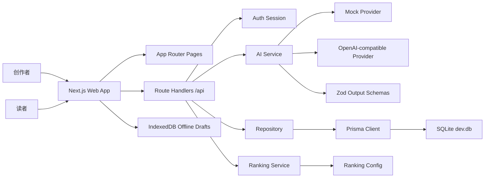
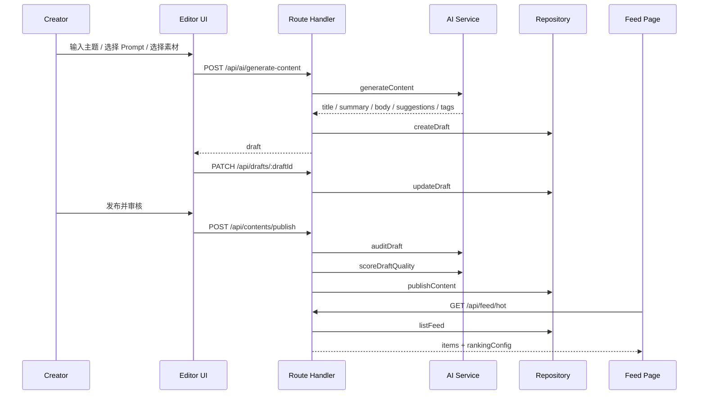

# 项目技术文档

## 1. 技术目标

本项目的技术目标是构建一个可运行、可演示、可解释的 AI 创作者辅助生产与分发平台。工程实现围绕一条主链路展开：

```text
登录
  -> AI 生成草稿
  -> 编辑器保存和离线同步
  -> 发布前审核
  -> 合规改写
  -> 质量评分
  -> 发布内容进入榜单
  -> 详情页解释排序原因
```

设计时优先保证主链路闭环和提交证据，而不是提前堆叠大量后台配置能力。所有关键模块都保留可替换边界，便于后续从 MVP 演示系统演进为更接近生产的系统。

## 2. 技术栈

| 层级 | 当前实现 | 选择理由 |
| --- | --- | --- |
| 应用框架 | Next.js App Router | 同一工程内完成页面、Route Handlers、生产构建和部署，适合训练营节奏 |
| 前端 | React + TypeScript | 类型约束清晰，便于构建复杂编辑器和榜单交互 |
| API 层 | Next.js Route Handlers | 轻量 BFF，满足 MVP 的登录、草稿、AI、发布、榜单接口 |
| 数据层 | Prisma + SQLite | 本地可快速运行；通过 repository 隔离，后续可迁移 PostgreSQL |
| AI 接入 | Mock Provider + OpenAI-compatible Provider | Mock 保证演示稳定，OpenAI-compatible 兼容火山方舟真实模型 |
| 输出校验 | Zod | 约束请求参数和 AI 结构化输出，避免模型自由文本进入业务链路 |
| 离线能力 | IndexedDB | 编辑器断网时保存本地草稿镜像，网络恢复后同步 |
| 图标 | lucide-react | 轻量、统一的图标库 |
| 自动化验证 | Playwright | 覆盖主链路、审核分支、离线同步、发布后编辑、榜单和治理 |

实际实现中未引入 Redis、对象存储和独立后端服务。它们是后续生产化替换点，不作为当前训练营提交的完成承诺。

## 3. 系统架构



关键原则：

- 页面只负责用户交互和视图状态。
- Route Handler 负责鉴权、参数校验、调用服务、返回统一响应。
- AI、审核、排序、数据访问放在 `src/server/*` 和 `src/lib/*`。
- 数据访问通过 repository 封装，API 不直接依赖 Prisma 表结构。

## 4. 核心目录

```text
src/app
  (auth)                  登录、注册页面
  (creator)               工作台、Prompt、素材、创作、编辑器
  (feed)                  榜单和内容详情
  api                     认证、AI、草稿、发布、榜单接口

src/server
  ai                      AI Service、Provider、输出 schema
  audit                   规则预筛
  auth                    Cookie 会话
  db                      Prisma 初始化
  feed                    榜单聚合
  ranking                 排序指标计算
  repositories            数据访问层

src/lib
  client-api              前端请求封装
  offline-drafts          IndexedDB 本地草稿
  ranking-config          榜单权重配置
  types                   共享业务类型

evals
  audit-cases.json        审核样例
  quality-cases.json      质量样例
  prompt-iterations.md    Prompt 调优记录
  scripts                 eval 与真实模型 smoke test

docs
  需求、架构、审核体系、评估报告、提交清单、技术留存
```

## 5. 主链路数据流



异常分支：

- 审核失败：返回风险分类、命中片段和建议动作，阻止发布。
- 合规改写：调用 `rewriteCompliantDraft` 生成替代标题和正文。
- 离线编辑：写入 IndexedDB，状态为 `local_pending`，网络恢复后同步。
- 内容下线：通过治理 API 将内容置为 `offline`，榜单和详情不再消费。

## 6. 数据模型

核心实体来自 `src/lib/types.ts` 和 `prisma/schema.prisma`：

| 实体 | 作用 |
| --- | --- |
| User | 演示用户、角色、昵称 |
| Prompt | 创作 Prompt 模板 |
| Asset | 素材元数据和基础合规状态 |
| Draft | 草稿、版本、同步状态、关联 contentId |
| Content | 发布内容、状态、正文、标签、发布时间 |
| AuditResult | 审核结果、风险类型、命中片段、处置动作 |
| QualityScore | 质量总分、六维评分、理由 |
| RankingMetric | 阅读热度、互动、质量、新鲜度、排序分 |
| AiCallLog | AI 调用类型、provider、模型、耗时、schema 结果 |
| GovernanceAction | 内容下线等治理动作记录 |

当前数据库是 SQLite 文件 `prisma/dev.db`，不会进入 Git。Prisma 7 在当前环境下 `db push` 不稳定，因此项目使用：

```text
prisma migrate diff
  -> prisma/generated-schema.sql
  -> prisma/apply-schema.mjs
```

这条路径由 `npm run db:push` 封装，对本地 SQLite 幂等应用 schema。

## 7. AI 能力接入

AI 层统一入口是 `src/server/ai/ai-service.ts`。

```text
Route Handler
  -> ai-service
  -> mock-provider / openai-compatible-provider
  -> Zod schema parse
  -> AiCallLog
```

当前支持四类任务：

| callType | 用途 | Schema |
| --- | --- | --- |
| `generate_content` | 生成短图文草稿 | `generatedContentOutputSchema` |
| `audit_content` | 内容安全审核 | `auditOutputSchema` |
| `rewrite_compliant` | 合规改写 | `rewriteOutputSchema` |
| `score_quality` | 质量评分 | `qualityScoreOutputSchema` |

Provider 策略：

- `mock`：默认模式，适合本地开发、演示和 E2E。
- `openai-compatible`：通过 `AI_BASE_URL`、`AI_API_KEY`、`AI_MODEL` 调用兼容服务。

真实模型 smoke test 已完成：

```text
provider=openai-compatible
baseUrl=https://ark.cn-beijing.volces.com/api/v3
model=ep-20260610224007-dm42x
generate_content OK 26572ms
audit_content OK 6429ms
rewrite_compliant OK 10334ms
score_quality OK 23667ms
summary 4/4 passed
```

工程处理过一个真实接入问题：当前模型不支持 `response_format: json_object`。因此 OpenAI-compatible Provider 不依赖 JSON mode，而是通过 prompt-only JSON 约束、JSON 提取、控制字符修复和 Zod 校验保证输出可用。

## 8. 审核与质量评分

审核体系由两层组成：

1. 规则预筛：`src/server/audit/rule-prescreen.ts`，覆盖明显风险词。
2. AI 审核输出：结构化返回 `passed`、`riskLevel`、`categories`、`hitSpans`、`action` 和 `suggestion`。

质量评分维度：

- 原创性。
- 结构完整度。
- 可读性。
- 信息密度。
- 标题吸引力。
- 图文匹配度。

当前 33 条审核样例和 3 条质量样例用于本地基线评估：

```text
Audit cases: 33/33 (100.0%)
Audit false positives: 0
Audit false negatives: 0
Quality cases: 3/3 (100.0%)
Eval schema failures: 0
```

这个结果证明当前规则和脚本在样例集内可稳定运行，不代表真实线上泛化准确率达到 100%。文档中应按“样例集基线”表述，而不是夸大为生产模型指标。

## 9. 榜单排序

榜单排序综合质量、热度、新鲜度和反馈：

```text
activeRankingScore =
  qualityScore * qualityWeight
  + heatScore * heatWeight
  + freshnessScore * freshnessWeight
  + feedbackScore * feedbackWeight
```

当前配置：

| 榜单 | 质量 | 热度 | 新鲜度 | 反馈 |
| --- | --- | --- | --- | --- |
| hot | 40% | 30% | 20% | 10% |
| viral | 20% | 45% | 10% | 25% |
| recommended | 55% | 15% | 15% | 15% |

详情页会根据 `?feed=` 参数展示对应榜单权重，让排序解释和入口场景一致。

## 10. 性能与部署

本地生产构建已通过：

```text
npm run build
```

当前线上体验通过生产构建 + Cloudflare quick tunnel 暴露：

```text
https://freedom-physicians-neighborhood-photographs.trycloudflare.com
```

部署验证脚本：

```bash
DEPLOY_URL=https://freedom-physicians-neighborhood-photographs.trycloudflare.com node scripts/verify-deployment.mjs
```

验证结果：

```text
verifiedFlow=login -> generate -> publish -> hot feed -> content detail
feed hot domContentLoaded=639ms
feed hot load=639ms
feed hot FCP=656ms
feed hot LCP=1488ms
threshold=2500ms
```

该 LCP 数据来自浏览器 `PerformanceObserver`。由于 quick tunnel 是临时入口，长期提交前可以替换稳定部署环境后复测。

## 11. 工程化与验证

项目提供以下验证命令：

```bash
npm run typecheck
npm run lint
npm run evals
npm run build
npm run e2e
```

E2E 覆盖：

- 登录、生成、保存、发布、榜单、详情主链路。
- 审核失败和合规改写。
- 离线草稿和恢复同步。
- 发布后编辑。
- 榜单加载更多和性能基线。
- 不同榜单权重。
- 内容下线治理。

真实模型 smoke test 单独运行：

```bash
npm run ai:smoke
```

需要配置 OpenAI-compatible 环境变量，不作为默认 E2E 依赖，避免外部服务耗时和稳定性影响主链路验证。

## 12. 当前边界与后续替换点

| 当前边界 | 原因 | 后续替换 |
| --- | --- | --- |
| Mock 认证 | 训练营演示优先，不接短信/邮箱服务 | 用户表密码加密、验证码、权限体系 |
| SQLite 本地数据库 | 降低启动成本 | PostgreSQL + 迁移脚本 |
| Mock AI 默认 | 保证演示和 E2E 稳定 | 真实模型灰度、超时重试、Prompt A/B |
| 本地素材 | 避免对象存储配置阻塞 | 对象存储、素材安全扫描 |
| 关键词规则预筛 | 快速建立审核闭环 | 语义模型、人工复核、误杀/漏判标注 |
| Quick tunnel 部署 | 快速获得公网验证 | 稳定云部署或命名 Tunnel |

这些边界都已经在 README、评估报告和自评中显式说明，避免把演示能力包装成生产能力。

